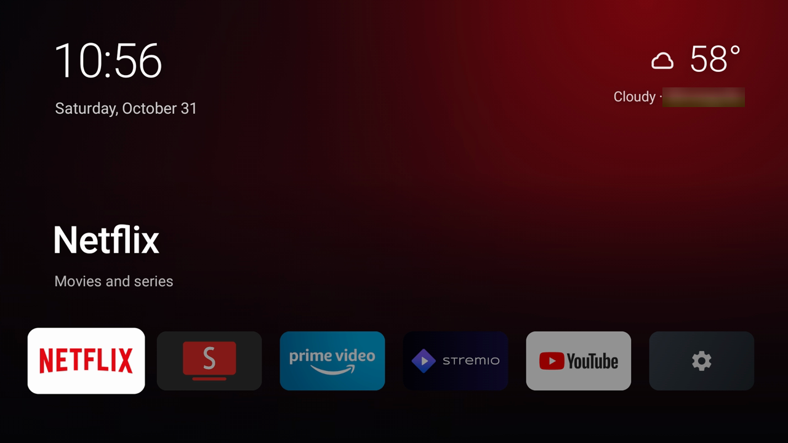

# Ad-free Fire TV home screen

Turns an Amazon Fire TV Stick into a fast, ad-free box for the few apps you actually use. Everything is done from a computer on the same Wi-Fi, over adb. No root and no third-party downloads on the TV.



## What it does

- **New home screen.** A clean, Apple TV–style launcher showing only your apps (Netflix, SmartTube, Prime Video, Stremio, YouTube by default) plus Settings. It shows the time, date and weather, and a "Rain in 45 min" / "Snow in 1 hour" heads-up when rain or snow is due. It runs at a steady 60 fps.
- **Takes over the Home button.** Pressing Home goes straight to the new screen. Amazon's home screen, and its banner ads, never show.
- **Debloat.** Optionally removes the third-party apps you don't use, and disables about 40 Amazon services for ads, tracking, sponsored content and promos. It also turns off Amazon features many people never use: screen mirroring, the web-casting receiver, Silk Browser, Amazon Kids, Ambient Experience, Amazon Music and Photos, shopping, games, and smart-home/Matter. Casting from the YouTube and Netflix phone apps still works. To keep any of these, delete its line from `DISABLE` in [config.sh](config.sh).
- **Ad-blocking DNS.** Points the TV at AdGuard DNS, which also stops ad traffic from the few Amazon services Fire OS won't let you disable.
- **No surprise updates.** Blocks Fire OS system updates, which would otherwise undo the debloat.
- **Frees RAM.** When you return home, the app you left is fully closed so the next one gets the memory. Free RAM went from ~485 MB to ~670 MB on a Fire TV Stick 4K.
- **More Apps.** A small underlined link below Settings opens a separate screen for extra apps, the RAM worker, and the Roborock S5. Use **+ Add apps** to choose installed Fire TV apps without changing the home dock.
- **Faster UI.** Shorter system animations, and the home screen is compiled ahead of time.

Everything can be undone with one script.

## Compatibility

Tested on a **Fire TV Stick 4K (2nd gen, AFTKM) with Fire OS 8.1.8.5**. Other Fire OS 8 devices should work. Fire OS 7 devices are handled in the code but untested. Vega OS devices can't run Android apps, so they won't work.

You need a Mac or a Linux PC (on Windows, use WSL) on the same network as the TV.

## 1. Prepare the Fire TV

1. **Turn on Developer Options:** *Settings → My Fire TV → About*, then click the device name 7 times.
2. **Turn on adb:** *Settings → My Fire TV → Developer Options → ADB debugging → On*.
3. **Find the TV's IP address:** *Settings → My Fire TV → About → Network*. It looks like `192.168.1.50`. A DHCP reservation on your router keeps it from changing.

The first time your computer connects, the TV asks **"Allow USB debugging?"**. Tick **Always allow from this computer** and press OK.

## 2. Get the code

```bash
git clone https://github.com/<you>/<repo>.git firetv-home
cd firetv-home
```

## 3a. Set it up with Claude Code

Install [Claude Code](https://claude.com/claude-code), then run `claude` inside the `firetv-home` folder and say what you want, for example:

> Set up my Fire TV at 192.168.1.50 using this repo. I use Netflix, SmartTube, Prime Video, Stremio and YouTube. Remove the other apps.

[CLAUDE.md](CLAUDE.md) tells Claude Code how the project works and which Fire OS pitfalls to avoid. It can install the tools below for you, use a different set of apps, change the home screen's look, and test the result on your TV. It confirms before uninstalling anything.

## 3b. Set it up manually

### Requirements

| What | macOS | Debian / Ubuntu / WSL |
|---|---|---|
| adb | `brew install android-platform-tools` | `sudo apt install adb` |
| JDK 17 | `brew install --cask temurin@17` | `sudo apt install openjdk-17-jdk` |
| zip | built in | `sudo apt install zip` |
| Android SDK build-tools + platform (API 30+) | Android Studio, or `brew install --cask android-commandlinetools` | Android Studio, or the "command line tools only" zip from developer.android.com |

If you use the command-line tools instead of Android Studio, install the two SDK parts with them:

```bash
sdkmanager --licenses
sdkmanager "build-tools;35.0.0" "platforms;android-35"
```

`launcher/build.sh` looks for the SDK in `$ANDROID_HOME`, then `~/Library/Android/sdk`, `~/Android/Sdk` and Homebrew's `android-commandlinetools` folder. If yours is somewhere else, `export ANDROID_HOME=/path/to/sdk`. Check that the tools work with `adb version` and `javac -version`.

### Choose your apps first

If you use different apps than the defaults, change the list before running anything, because `--remove-apps` uninstalls every app that isn't on it. The list lives in three places:

| File | What to change |
|---|---|
| [config.sh](config.sh) | `APPS`: kept by debloat, background-restricted, and closed by the RAM cleaner |
| [launcher/src/com/custom/tvhome/AppCatalog.java](launcher/src/com/custom/tvhome/AppCatalog.java) | the home screen tiles: package name, title, subtitle, accent color |
| [launcher/AndroidManifest.xml](launcher/AndroidManifest.xml) | the `<queries>` list (Android 11 needs it to see the apps) |

The dock fits six tiles: five apps plus Settings. Find an app's package name with `adb shell pm list packages | grep -i <name>`.

### Steps

Replace `192.168.1.50` with your TV's IP.

```bash
# 1. Debloat: disable Amazon ads/tracking, block updates, ad-blocking DNS, faster animations.
#    --remove-apps lists the third-party apps not in APPS and asks before uninstalling them.
./debloat.sh 192.168.1.50 --remove-apps

# 2. Build/install, reboot, then reconnect and verify the automatic RAM worker.
launcher/install.sh 192.168.1.50

# install.sh waits for boot and starts the RAM worker before reporting completion.
```

`debloat.sh` options:
- `--remove-apps`: uninstall third-party apps that aren't in `APPS`.
- `--yes`: don't ask before uninstalling.
- `--no-dns`: leave DNS alone.
- `--keep-updates`: don't block Fire OS updates.

## More Apps and restarting the RAM worker

Focus **Settings**, press **Down**, then select **More Apps >**. The original six home tiles stay in place.

- **RAM cleaner → Restart worker** replaces the automatic background worker. It does not open individual app settings or ask you to force-stop apps. A response from the shell process confirms the restart.
- **+ Add apps** lists launchable apps installed on the Fire TV. Select an app to add or remove it from More Apps, then press Back. These shortcuts persist after reboot. To remove a shortcut directly, focus it in More Apps and hold Select or press Menu, then choose **Remove shortcut**. This does not uninstall the app. Adding a shortcut does not add system apps to the RAM cleaner's allowlist; that remains `APPS` in `config.sh`.
- **Roborock S5** opens the local Valetudo interface. The TV discovers `Valetudo MedicalUnwelcomeShark Web` via DNS-SD because this Fire OS build cannot resolve the `.local` hostname directly. Use arrows to move the pointer, Select to click, Menu to switch between pointer movement and scrolling, Play/Pause to toggle fitted and larger views, and Back to return. The browser renders into a larger virtual viewport and scales into the TV-safe area so fixed panels are not cropped by the toolbar. The vacuum stays entirely on the local network.

The shell supervisor automatically replaces a worker that exits, and the worker reconnects if its log reader exits. The button also lets you deliberately restart the worker while its supervisor remains available.

## After a reboot or power loss

Fire OS ends the RAM cleaner whenever the stick restarts or loses power. Start it again with:

```bash
cleaner/start_cleaner.sh 192.168.1.50
```

Turning the TV off with the remote only puts the stick to sleep, so the cleaner keeps running. If your stick is powered from the TV's USB port and the TV cuts that power when it turns off, use the wall adapter instead. Everything else (home screen, ad blocking, Home button) survives reboots on its own.

The launcher cannot restore shell privileges after a power loss: this device blocks local ADB. In that case the worker dialog reports offline. Restarting without a computer requires an approved ADB connection from another always-on device. A service on the Valetudo vacuum is a possible host, but requires its SSH login and a compatibility check before deployment; it is not currently installed.

## How it works

- **Home screen** (`launcher/`): a small Android app written in plain Java with no libraries, built with the SDK command-line tools (no Gradle). Backdrops are pre-rendered bitmaps, which keeps it at 60 fps on the stick's weak GPU.
- **Home button**: Amazon's launcher can't be disabled, and Fire OS doesn't pass the Home key to apps. An accessibility service watches the system log for the moment Amazon's home starts; that's why `install.sh` grants `READ_LOGS`. The service then covers the screen with an identical copy of the new home screen and brings the real one up underneath, so you never see Amazon's.
- **RAM cleaner** (`cleaner/`): Fire OS ignores app-kill requests from apps and blocks apps from using adb on the TV itself. A small supervisor runs as the adb shell user and owns the automatic worker. The worker closes configured apps whenever home opens, checks the foreground before each app, and retries interrupted log readers. The supervisor restarts an exited worker or handles a fixed `RESTART` request from More Apps. Startup checks an actual response, rather than just the presence of a process. Diagnostics are bounded in `/data/local/tmp/firetv_cleaner.log` and one rotated copy.
- **Weather**: the city comes from your public IP (GeoJS, with ipapi.co as backup). Current conditions and the 15-minute rain/snow forecast come from Open-Meteo. No accounts or keys, and these are the home screen's only network requests.

## Undo everything

Run this from the same folder you ran `debloat.sh` in. It reads `backup/disabled_packages.txt` to know what to re-enable; without that file, it re-enables the whole `DISABLE` list instead.

```bash
./restore_firetv.sh 192.168.1.50
adb -s 192.168.1.50:5555 reboot
```

This removes the home screen and cleaner, re-enables the Amazon services, re-allows updates, and resets DNS and animations. Apps removed with `--remove-apps` have to be reinstalled from the Appstore.

## Troubleshooting

| Problem | Fix |
|---|---|
| `unauthorized` / "Accept the prompt" | Look at the TV, tick *Always allow*, press OK, and run the command again. |
| Amazon's home screen shows after reinstalling | Fire OS only re-attaches the Home service after a reboot. `install.sh` reboots for you; if you installed by hand, reboot. |
| `INSTALL_FAILED_UPDATE_INCOMPATIBLE` | It was installed from another computer, with a different signing key. Run `adb -s <ip>:5555 uninstall com.custom.tvhome`, then `install.sh` again. |
| `javac not found` / `zip not found` | Install the JDK and zip from Requirements, and check with `javac -version`. |
| Weather is blank | It appears within a minute or two of the TV having internet. After that it's cached. |
| Home button stopped working after a Fire OS update | Run `launcher/install.sh <ip>` again. It re-enables the accessibility service. |
| Worker is offline after a reboot | Start `cleaner/start_cleaner.sh <ip>` from an approved external device. The TV cannot regain shell privileges by itself. |
| Valetudo cannot be found | Check that the vacuum and TV share Wi-Fi and that multicast/mDNS is allowed. The configured DNS-SD service name is in `LocalVacuum.java`. |

Host-side checks: `python3 cleaner/test_cleaner.py`, `python3 cleaner/test_install.py`, and `python3 cleaner/test_supervisor.py`. The installer only reports completion after the rebooted TV responds and the worker starts successfully. The launcher still builds with the SDK tools directly; `javac --release 8` and `d8` handle Java lambdas without Gradle.

## Things to know

- **No security updates.** Blocking Fire OS updates also blocks security fixes. Use `--keep-updates` if that matters more to you, or run `restore_firetv.sh` before updating.
- **adb stays on.** Anyone on your network can try to connect, but each new computer still has to be approved on the TV.
- **Not from Amazon.** This project isn't affiliated with Amazon. Use at your own risk; everything it changes can be reverted.
- **Settings icon:** from Google's [Material Icons](https://fonts.google.com/icons), under the Apache License 2.0.
